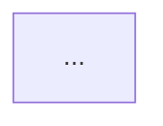

# System docs

A maintainer opens this doc to change the system safely. They need the ideas the code is built on, a picture of how the parts interact, and where to start. They do not need a history of the project, marketing, or a list of links. Define the core concepts first, because every later sentence uses them; draw what is easier to see than to read; keep every sentence checkable against the code.

**Side effects:** writes one doc (default `docs/<system>.md`, or the path the user names, or the existing doc it updates) and nothing else. Reads the code; may spawn a fresh-context subagent as the test reader. Never edits code, posts or commits.

## When to use

- A feature or system has been built and the people who maintain it need to understand it.
- The user asks how a system works "for the docs", or for maintainer, architecture or onboarding docs of existing code.
- Phase 6 of `deliver`.

## When not to use

- A design for something not yet built: `design-doc`.
- A decision and its reasons: `adr`.
- On-call steps for incidents: `runbook`.
- API reference generated from code comments: use the language's doc tool.

## Inputs to gather

- The code, SPEC.md (for the data model, module diagram and decisions) and any ADRs.
- Existing docs: update the one that covers this system rather than adding a second. Note the repo's doc folder and conventions.
- The audience: maintainers of this code (default), or another team integrating with it.
- The terms the team uses in code, tickets and the spec; the doc uses the same words.

## Procedure

1. **Pick the core concepts:** the 3-8 terms a maintainer must know (entities, states, roles, mechanisms). Define each in one or two sentences and name where it lives in code (type, table, module). Use the code's own names.
2. **Draw how it works.** Choose diagrams by question, and keep each under about 12 nodes:
   - What talks to what: a Mermaid `flowchart` of components and data flow; when the doc covers how two systems or mechanisms interact, show both and the boundary between them.
   - What happens, in order, when logic is complicated (several actors, retries, async steps, state changes): a `sequenceDiagram`, one per flow that needs it.
   - What the data looks like: an `erDiagram` or `classDiagram` of the core concepts.
   - What states something moves through: a `stateDiagram-v2`.
   Under each diagram, write two to four sentences on what to notice. A diagram that needs a paragraph of explanation is too big; split it.
3. **Write the rest in this order** (template in Output): where to make common changes (entry points by task), invariants and gotchas (what breaks if you get it wrong, and how you'd notice), and how to run, test and debug it locally (exact commands).
4. **Plain and specific.** One idea per sentence; active voice; the code's names in backticks. Replace each vague phrase ("handles", "robust", "various", "etc.", "seamlessly") with what actually happens. Link only to code paths and to at most one external page per concept; never a chain of links standing in for an explanation.
5. **Check against the code.** Every file, function, type, command and config key named in the doc exists (search for each). Every diagram node maps to a real module and every arrow to a real call, message or read. Run every command you list.
6. **Fresh-reader test.** Give a fresh-context subagent only the doc and 3-5 maintainer questions ("where would you add a new X?", "what happens when Y fails?"). Check its answers against the code; fix the doc where it got them wrong or had to guess.
7. **Keep it short.** Cut anything that does not help a maintainer change the system. Present the doc for approval.

## Verification

- Core concepts come first; each has a definition and a code location.
- Every named file, symbol, command and config key was found in the repo; every command ran.
- Every diagram renders as Mermaid and matches the code (node to module, arrow to call).
- Every complicated flow has a sequence diagram; no diagram above about 12 nodes.
- The fresh reader's answers matched the code, or the doc was fixed.
- No vague words from step 4 remain; no link chains.

## Gotchas

- **Concepts buried mid-doc.** Readers meet terms before definitions and guess. Concepts first.
- **Diagrams of everything.** A 40-box diagram explains nothing. One question per diagram.
- **Docs that drift.** Names copied from the spec instead of the code go stale on day one. Check against the code, not the plan.
- **Explaining the obvious, skipping the surprising.** Maintainers can read the code for what it does; the doc earns its place with why, how the parts connect, and what breaks.
- **A second doc for the same system.** Two docs disagree within a month. Update the existing one.

## Output

````markdown
# <System or feature>
<One paragraph: what it does, for whom, and its boundaries (what it does not do).>

## Core concepts
| Concept | Meaning | In code |
|---|---|---|
| <term> | <one or two sentences> | `<type / table / module>` |

## How it works

<2-4 sentences on what to notice.>

### <Flow name>
```mermaid
sequenceDiagram
  ...
```
<2-4 sentences.>

### Data model
```mermaid
erDiagram
  ...
```

## Where to change things
| To... | Start in | Also touch |
|---|---|---|

## Invariants and gotchas
- <rule> - breaks <what> if violated; you'd notice by <symptom or failing test>.

## Run, test, debug
- Run: `<cmd>`  Test: `<cmd>`  Logs/debug: `<how>`
````

## Sources

- Diátaxis, Daniele Procida (explanation is understanding-oriented; reference is information-oriented), read Nov 2026: https://diataxis.fr/
- C4 model, Simon Brown (context, container, component, code: one diagram per level of question), read Nov 2026: https://c4model.com/
- arc42, section 12 Glossary (shared business and technical terms), read Nov 2026: https://docs.arc42.org/home/
- Mermaid syntax (flowchart, sequenceDiagram, classDiagram, erDiagram, stateDiagram-v2), docs v12.3, read Nov 2026: https://mermaid.js.org/syntax/flowchart.html
- GitHub, "Include diagrams in your Markdown files with Mermaid", 14 Feb 2022, updated 23 Jul 2024: https://github.blog/2022-02-14-include-diagrams-markdown-files-mermaid
- Google Technical Writing One, "Short sentences" (one idea per sentence), updated 28 Mar 2025: https://developers.google.com/tech-writing/one/short-sentences
- Google developer documentation style guide, highlights (active voice, second person), updated 9 Oct 2026: https://developers.google.com/style/highlights
- Nelson Cowan, "The magical number 4 in short-term memory" (why diagrams stay small), Behavioral and Brain Sciences 24(1), 2001: https://memory.psych.missouri.edu/assets/doc/articles/2001/cowan-bbs-2001.pdf
