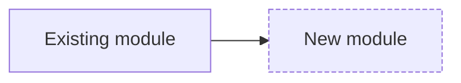

# Grill

Turn a fuzzy request into a SPEC.md that two different implementers would build the same way, and that a reviewer can check the result against. The interview resolves decisions by asking short multiple-choice questions; the spec records them, with acceptance criteria written as checks an agent can run.

**Side effects:** writes SPEC.md (or the path the user names) and runs the project's tests once. No external reads. Edits to other repo files, such as domain notes, are proposed and written only on approval; never commits, pushes or posts.

## When to use

- A new feature, behaviour change or refactor is proposed and no code exists yet.
- The request has more than one reasonable reading, or misses error, empty or edge cases.
- The work will be built in a fresh session, by another agent, in the background, or unattended.
- The user asks to be grilled or interviewed, or asks for a spec or plan.

## When not to use

- Small or familiar changes with one obvious approach: restate goal and done-check in one or two lines in chat and proceed.
- A bug with a symptom: use `diagnose` and start from a failing reproduction test.
- A cross-system design with real trade-offs between alternatives: use `design-doc` (documentation); this skill can feed it.

## Inputs to gather

Read before asking; never ask the user something the repository answers.

- The relevant code, an existing file that already follows the pattern to copy, and any docs or ADRs.
- `CLAUDE.md` or `AGENTS.md`, domain notes (for example `docs/CONTEXT.md`) and research notes (`docs/research/`). If the task needs investigation whose answer will be reused (a library choice, architecture archaeology), recommend a `research` session first rather than burying it in the interview.
- The project's test, typecheck and lint commands. Run the tests once ("first run the tests") to learn the command and how big the suite is.
- Constraints stated or implied: no new libraries, compatibility promises, performance budgets.
- Who signs off on the spec, and whether the build will run unattended.

## Procedure

1. **Size the change** and record the choice:
   - Small (local, one obvious approach): no interview; a two-line goal plus check in chat.
   - Medium (several files or one real decision): short interview, short SPEC.md.
   - Large, handed off, or unattended: full interview, full SPEC.md, build in a fresh session.
2. **Explore first.** Read the code and docs above. Write down what you learned that removes questions, and the file you will point the implementer at as the pattern to follow.
3. **List the open decisions** as a tree, starting with the premise: is this the right problem, and would a smaller change do? Typical branches: user-visible behaviour, inputs and outputs, error and empty states, edge cases, interfaces and data shape, compatibility and migration, rollout, what is explicitly out of scope, and how "done" will be checked. Drop any branch the code already settles.
4. **Data model first, then the module diagram** (medium and large changes). Once the premise branch is settled and before any component question, draft the data structures the change needs: entities, fields and types, invariants, ownership, and where each is stored. Infer them from existing models, schemas and the request, and ask only what the code and request leave open. Then draw a Mermaid module diagram (`flowchart` or `classDiagram`) of the components to build or change and their dependencies, with new modules visibly distinct from existing ones. Show both to the user and let them adjust; redraw until approved. Both go into SPEC.md, and later questions build on them.
5. **Ask one decision at a time, multiple choice.** For each question give 2 to 4 concrete options, mark your recommended option with a one-line reason, and allow "other". Ask the question whose answer changes the most downstream decisions first. Do not ask about anything with no effect on the implementation.
6. **Play back after each branch.** Summarise the decisions so far in two or three lines and let the user correct them before going deeper. Record every answer in a decisions list as you go.
7. **Ask for the ambitious version explicitly.** Models read requests conservatively; ask directly whether edge cases, empty and error states, accessibility and keyboard handling are in scope rather than assuming.
8. **Stop when the tree is closed.** The stop rule: every goal maps to at least one acceptance check, and no remaining question would make two implementers diverge. Anything the user cannot answer now goes under Open questions with an owner; never fill it with a silent guess.
9. **Write SPEC.md** (or the path the user names, such as `docs/plans/YYYY-MM-DD-<slug>.md` where the repo keeps plans) using the template in Output. Split the work into vertical slices, each one verifiable on its own, and give each its gate: a failing test against a named public seam (confirmed with the user during the interview) for logic, or the exact command or flow that proves it for glue, UI and config. Write acceptance criteria as checks: a test name or command plus the expected result, or input/output pairs a test can assert. Mark any check that cannot be automated as manual and say what evidence proves it (screenshot, curl output, log line).
10. **For unattended or handed-off work**, answer these five questions inside the spec: what done looks like, how the agent checks its own work, what it may touch, what stops it (turn or budget cap), and where the result goes and who signs off.
11. **Get explicit approval**, then hand off. If the interview settled a real decision between alternatives, record it with `adr` (documentation); if it surfaced durable domain facts, propose the addition to the repo's domain notes and write it on approval. Then: build from SPEC.md in a fresh session or by another agent, and later point the reviewer at the same SPEC.md. Optional, Claude Code: `/clear` or a new session; Cursor: save the plan to `.cursor/plans/` if the user wants it kept, and start a new chat.
12. **Keep it current.** When a decision changes during the build, edit the spec in place rather than appending amendments, so the reviewer checks against what was actually agreed.

## Verification

Before calling the spec done, confirm and show:

- Every goal has at least one acceptance check, and every check names a command, test or explicit manual evidence.
- Each check could fail: it asserts a specific value, status or state, not "works correctly".
- Non-goals list things that could reasonably have been in scope, not filler.
- Open questions each have an owner; none is hidden inside a goal.
- The user approved the decisions list (quote their confirmation or note the turn).
- For unattended work, all five unattended-run questions are answered.
- Every slice has a gate: a named seam for test-driven slices, or an exact command or flow for the rest.
- For medium and large changes, the data model and the module diagram are in the spec and the user approved them; the diagram renders as Mermaid.

## Gotchas

- **Asking what the code answers.** Each unnecessary question costs the user attention and makes the interview feel like a form. Explore first; ask only about intent and trade-offs.
- **Open-ended questions get vague answers.** "How should errors work?" yields a paragraph; "On a timeout: (a) retry once, (b) surface the error, (c) return cached data — I recommend (b) because..." yields a decision.
- **Batching ten questions at once.** Users answer the easy ones and skip the decisive ones. Keep to one decision (or a tightly related pair) per turn.
- **Untestable acceptance criteria.** "Fast", "robust" and "user-friendly" are not checks. Convert each to a measurable condition or move it to Open questions.
- **Non-goals as an afterthought.** In Google-style design docs a non-goal is something that could reasonably have been a goal but was deliberately excluded. That is what stops scope creep in the build.
- **One spec covering several concerns.** If a spec's purpose cannot be stated in one sentence without "and", split it; each spec then gets its own acceptance checks.
- **Spec ritual on small changes.** Over-specifying a one-file fix costs more than it saves. Scale the spec down rather than skip the agreement step.
- **Building in the interview session.** The interview context is full of rejected options. Building from the written spec in a fresh session is the documented pattern, and it tests whether the spec is complete on its own.
- **Unattended runs on a wrong assumption.** An unattended run without a clear done-condition can build all night on a wrong assumption. The five-question check in step 10 is the guard.

## Output

Write `SPEC.md` (or the path the user names) in this shape, then report the path and the decisions list in chat.

````markdown
# SPEC: <feature name>
Status: draft | approved (<who>, <date>)   Size: small | medium | large

## Context
<2-5 sentences: current behaviour, why change it, link to issue>

## Goals
1. <user-visible outcome>

## Non-goals
- <reasonable thing deliberately out of scope, and why>

## Decisions
| # | Question | Chosen | Rejected options | Reason |
|---|---|---|---|---|

## Data model
<entities, fields and types, invariants, ownership, storage; or "unchanged">

## Module diagram


## Behaviour
- Inputs / outputs: ...
- Error and empty states: ...
- Edge cases: ...
- Pattern to follow: <path/to/existing/file>
- Constraints: <e.g. no new dependencies, backward compatible API>

## Acceptance criteria (executable)
| ID | Check | How to run | Expected result |
|---|---|---|---|
| AC1 | <behaviour> | `<test command or test name>` | <exact pass condition> |
| AC2 | <behaviour> | manual: <steps> | <evidence: screenshot / curl output> |

## Slices (build in order)
| # | Change | Gate | Verification | Done |
|---|---|---|---|---|
| 1 | <small, concrete> | TDD: <public seam> / E2E: <command> | <expected result> | [ ] |

## Context for the build session
<file paths and facts a fresh agent with no history needs; nothing that is already in the code>

## Unattended-run answers (only if run unattended or handed off)
- Done looks like: AC1-ACn pass with output attached
- Self-check: <command>
- May touch: <paths>; must not touch: <paths>
- Stops at: <turn cap / budget cap / first failing AC after N tries>
- Result goes to: <branch / PR>; signed off by: <person>

## Open questions
| Question | Owner | Needed by |
|---|---|---|
````

## Sources

- Anthropic, Claude Code best practices (interview with multiple-choice questions until SPEC.md can be written; build in a fresh session; review against the same spec; "be ambitious"; unattended-run checklist), current docs read Oct 2026: https://code.claude.com/docs/en/best-practices
- Anthropic, Claude Code common workflows (scheduled prompts must state what success looks like), read Oct 2026: https://code.claude.com/docs/en/common-workflows.md
- Cursor, "Best practices for coding with agents" (Plan Mode clarifying questions, skip planning for small tasks, revert and replan on drift), Lee Robinson, 9 Jan 2026: https://cursor.com/blog/agent-best-practices
- Matt Pocock, `grill-me` / `grill-with-docs` skills (interview until decisions are settled, check the codebase), aggregator description read Oct 2026: https://vibeindex.ai/collection/mattpocock/skills
- Mermaid, flowchart and class diagram syntax, read Nov 2026: https://mermaid.js.org/syntax/flowchart.html
- Jesse Vincent, obra/superpowers `brainstorming` (play back intent; small changes in chat, larger ones get a design doc), README read Oct 2026: https://github.com/obra/superpowers
- Malte Ubl, "Design Docs at Google" (goals and non-goals; update the doc when the design changes), 6 Jul 2020: https://www.industrialempathy.com/posts/design-docs-at-google/
- Simon Willison, "First run the tests", ~24 Feb 2026: https://simonwillison.net/guides/agentic-engineering-patterns/first-run-the-tests/
- The Ralph Playbook (one spec per topic of concern; one-sentence-without-"and" test), ~Jan 2026: https://github.com/ghuntley/how-to-ralph-wiggum
